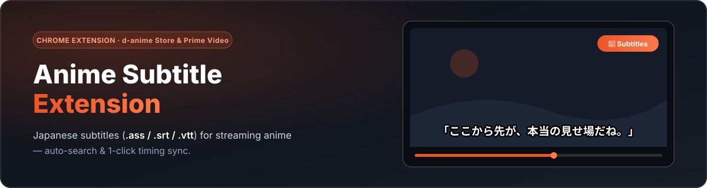
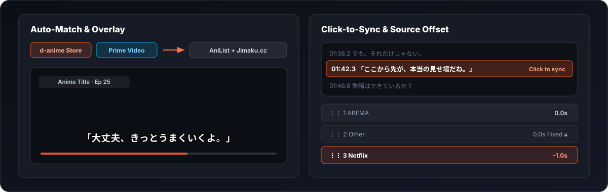
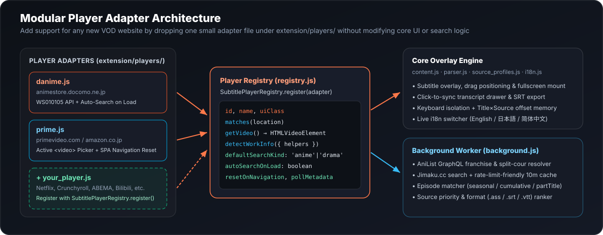

<div align="center">



# 字幕オーバーレイアシスタント (Subtitle Overlay Assistant)

**dアニメストア・Amazon Prime Video などの動画配信プレイヤーに外部字幕（`.ass` / `.srt` / `.ssa` / `.vtt`）を重ねて表示できる Chrome 拡張機能（MV3）。Jimaku.cc + AniList の高精度自動検索、台詞クリックによる直感的なタイミング同期、プレイヤー別の拡張しやすいモジュラー設計を備えています。**

[](LICENSE)
[](extension/manifest.json)
[](extension/i18n.js)
[](extension/players/registry.js)

[English](README.md) | **日本語** | [简体中文](README.zh-CN.md)

</div>

---

## 機能ビジュアル紹介



---

## 開発の背景

日本語学習者や聴覚に配慮した字幕を必要とする視聴者、複数の動画配信サービスを利用するユーザーにとって、字幕のない作品や自動生成字幕の精度不足は大きな課題でした。

**Subtitle Overlay Assistant** は、フルスクリーン再生時を含め、手元の動画プレイヤー上に視認性の高い外部字幕をオーバーレイ表示します。初期状態で **dアニメストア** と **Amazon Prime Video** の双方に対応し、サイト固有のプレイヤー処理をベースエンジンから切り離しているため、他の配信サイト向けアダプターも容易に追加できます。

---

## 対応プラットフォーム

| プラットフォーム | アダプター | 動作仕様 |
| :--- | :--- | :--- |
| **dアニメストア** (`animestore.docomo.ne.jp`) | [`extension/players/danime.js`](extension/players/danime.js) | `WS010105` API および DOM から作品名・話数・サブタイトル（`partTitle`）を自動取得し、再生開始時に最適な日本語字幕を自動検索・適用します。 |
| **Amazon Prime Video** (`primevideo.com`, `amazon.co.jp`) | [`extension/players/prime.js`](extension/players/prime.js) | アクティブで最大の `<video>` を自動検出し、`atvwebplayersdk` DOM から作品情報・エピソードを取得。ドラマ/アニメ検索や SPA 画面遷移時の自動リセットに対応しています。 |
| **その他の配信サイト** | モジュラーアダプター API | `extension/players/` 配下にアダプターファイルを1つ追加するだけで対応可能です（[新しいプレイヤーの追加方法](#コントリビューター向け新しいプレイヤーアダプターの追加)）。 |

---

## 主な機能

- **シリーズ・分割クール対応のスマート検索 (`Jimaku.cc` + `AniList`)**
  - AniList GraphQL の続編チェーンを辿り、2期以降や分割クールの「通算話数 vs 期別話数」を自動変換・フォールバック検索します。
  - `【推しの子】` などタイトル固有の括弧を壊さず、`【放送版】` などの配信タグのみを適切に除去します。
  - 話数サブタイトル（`partTitle`）照合や、実写・ドラマ検索モードにも対応。候補フォルダが複数ある場合は上から順に最適ファイルを探索し、ユーザーが選んだ候補を自動記憶します。
- **開閉式＆ドラッグ並び替え対応「ソース優先順 & 標準オフセット」辞書**
  - 優先したい字幕ソースの並び順と、ソースごとの基準オフセット（例：`Netflix` は初期値 `-1.0s`）を1対1の辞書として管理できます。
  - 動画視聴中でも邪魔にならないよう折りたたみ式になっており、必要な時だけ展開してドラッグ（`⋮⋮`）で優先順を並び替え、各行の右側で標準オフセットを直接調整できます。
  - カスタムソースの追加・削除にも対応。`Other` はドラッグで優先順位を変更できますが、標準オフセットは `0.0s` 固定で削除不可となっています。
- **作品別・ソース別のタイミング自動記憶**
  - 適用時の優先順位：`作品 × ソース記憶` → `作品記憶` → `ソース辞書の標準オフセット` → `0.0s`。
- **クリックでタイミング調整（トランスクリプトドロワー）**
  - 再生画面に表示されている字幕をクリック（またはフォーカスして `Enter` / `Space`）すると字幕一覧ドロワーが開きます。
  - 今聞こえた台詞をクリックするだけで全体タイミングを即座に合わせる「この台詞を今に合わせる」モードと、指定の台詞へシークする「この台詞へ動画を移動」モードを切り替えられます。
- **ローカル字幕ファイル読込 & SRT エクスポート**
  - `.ass` / `.ssa` / `.srt` / `.vtt` に対応（2言語同居 ASS ファイルの非日本語スタイル行自動スキップ機能付き）。
  - ページ上どこでも字幕ファイルをドラッグ＆ドロップで適用でき、`.srt` 形式での書き出しにも対応しています。
- **見やすい初期スタイルと快適な操作性**
  - 初期値は動画の高さに応じた **文字サイズ比率 `4.5%`**・**下からの位置 `5%`**・**背景不透明度 `0%（透明）`**＋黒縁取り文字。
  - パネル入力中のキー操作は配信プレイヤー側に伝播させないため、`Space`・矢印キー・`F`・`M` 等が誤動作しません。
  - API キー入力欄にはブラウザの「パスワード保存」ポップアップ抑制対策を適用しています。
- **完全多言語対応（`English` / `日本語` / `简体中文`）**
  - 拡張機能のメタデータ（`_locales`）およびパネル・ポップアップ内 UI のリアルタイム言語切り替えに対応しています。

---

## インストール方法

1. リポジトリをクローンまたはダウンロードします：
   ```bash
   git clone https://github.com/kysing02/video-subtitle.git
   ```
2. Chrome で `chrome://extensions/` を開きます。
3. 右上の **「デベロッパーモード」** をオンにします。
4. **「パッケージ化されていない拡張機能を読み込む」** から、本リポジトリ内の [`extension/`](extension/) フォルダを選択します。
5. *(自動検索を使う場合)* [jimaku.cc/account](https://jimaku.cc/account) で無料の API キーを取得し、拡張機能のポップアップまたはプレイヤーパネル内の「⚙ 設定」タブに貼り付けて保存します。

---

## キーボードショートカット・操作一覧

| 操作 | ショートカット / 操作方法 |
| :--- | :--- |
| 字幕の表示 ON / OFF | `Alt + S` |
| タイミング微調整 (`-0.5s` / `+0.5s`) | `[` / `]` |
| 字幕一覧を開いてクリック同期 / シーク | 表示されている字幕テキストをクリック |
| 字幕の表示位置（上下）を変更 | 表示されている字幕テキストを上下にドラッグ |
| クイックタイミング補正 (`-5s` 〜 `+5s`) | パネル下部のタイミングコントロール |

---

## コントリビューター向け：新しいプレイヤーアダプターの追加



各配信サイト向けの処理は [`extension/players/`](extension/players/) に分離されており、字幕オーバーレイ描画・タイミング同期・多言語UI・Jimaku 検索エンジンに触れることなく新しいサイトを追加できます。

### 1. `extension/players/<site>.js` を作成

`window.SubtitlePlayerRegistry.register(...)` を呼び出してアダプターを登録します：

```js
(function (root) {
  'use strict';

  const registry = root.SubtitlePlayerRegistry;
  if (!registry) return;

  registry.register({
    id: 'myvod',
    name: 'MyVOD',
    matches: (loc) => /(^|\.)myvod\.example$/.test(loc.hostname),

    defaultSearchKind: 'anime', // 'anime' または 'drama'
    autoSearchOnLoad: true,     // true: メタデータ取得時に自動で字幕検索＆適用
    resetOnNavigation: true,    // true: SPA URL変更時に現在の字幕をリセット
    pollMetadata: true,         // true: 作品情報・話数DOMを定期チェック
    alwaysResolveVideo: false,  // true: 描画毎に対象の <video> 要素を再解決
    uiClass: '',                // 任意のテーマ用クラス名

    getVideo() {
      return document.querySelector('video');
    },

    async detectWorkInfo({ cleanWorkTitle, parseEpisodeNumber }) {
      const rawTitle = document.querySelector('.player-title')?.textContent?.trim() || '';
      const rawEp = document.querySelector('.player-episode')?.textContent?.trim() || '';
      if (!rawTitle) return null;
      return {
        partId: location.pathname,
        workTitle: rawTitle,
        cleanTitle: cleanWorkTitle(rawTitle),
        partDispNumber: rawEp,
        partTitle: '',
        episodeNumber: parseEpisodeNumber(rawEp),
      };
    },
  });
})(typeof window !== 'undefined' ? window : globalThis);
```

### 2. `extension/manifest.json` に登録

1. `host_permissions` と `content_scripts[0].matches` に対象ドメインを追加します。
2. `content_scripts[0].js` の `"players/registry.js"` より後、`"content.js"` より前に `"players/<site>.js"` を追加します。

### 3. 構文チェック＆オフラインブラウザテスト実行

```bash
node -c extension/players/<site>.js extension/content.js extension/background.js
python3 tests/build-browser-fixture.py
python3 tests/build-browser-fixture.py --search
google-chrome --headless --disable-gpu --no-sandbox --dump-dom "file:///tmp/prime-subtitle-test.html" | grep 'id="result"'
google-chrome --headless --disable-gpu --no-sandbox --dump-dom "file:///tmp/subtitle-search-test.html" | grep 'id="result"'
```

---

## ブランチ構成

- `main`: 安定版リリースブランチ
- `dev`: 機能統合・検証用ブランチ
- `feat/ai-realtime`: 実験的なリアルタイム AI 音声文字起こし機能を分離して管理している開発ブランチ

---

## ライセンス

[MIT License](LICENSE)
