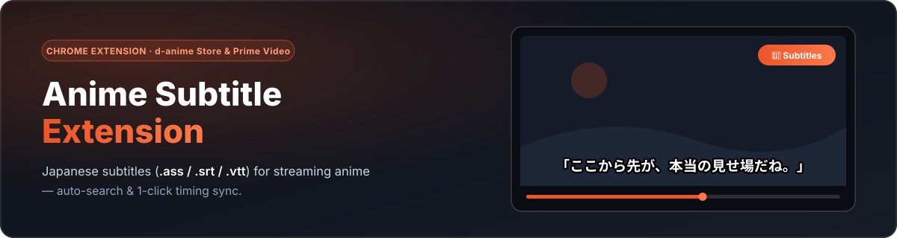
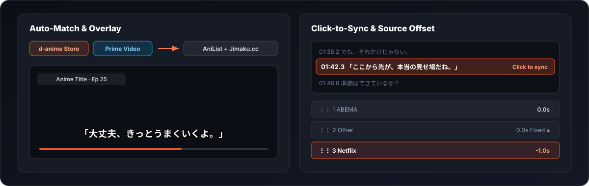

<div align="center">



# Anime Subtitle Extension

**Add Japanese subtitles (`.ass`, `.srt`, `.ssa`, `.vtt`) to streaming anime on d-anime Store and Amazon Prime Video — with Jimaku.cc + AniList auto-search and 1-click timing sync.**

[](LICENSE)
[](https://github.com/kysing02/anime-subtitle-extension/releases/latest)
[](extension/manifest.json)
[](extension/i18n.js)
[](extension/manifest.json)

**English** | [日本語](README.ja.md) | [简体中文](README.zh-CN.md)

</div>

---

## Visual Overview



---

## Features for Anime Viewers

- **Supported Players (d-anime Store & Amazon Prime Video)**
  - Automatically detects anime titles, episode numbers, and episode subtitles on **d-anime Store** and searches/applies subtitles as soon as playback starts.
  - Also supports **Amazon Prime Video** (anime & live-action drama search) with automatic episode reset during playback navigation.
- **Season & Split-Cour Auto-Resolution (`AniList` + `Jimaku.cc`)**
  - Uses AniList franchise chains to match Season 2+ and split-cour numbering (cumulative vs. per-season episodes) and remembers your chosen Jimaku entry per anime.
- **Click-to-Sync Transcript**
  - Click any subtitle on screen to open the scrollable dialogue list and align the entire subtitle timing to the line currently spoken — or switch to seek mode to jump to any line.
- **Source Priority & Auto-Offset Dictionary**
  - Expandable, drag-to-reorder source priority list (`ABEMA`, `DMMTV`, `U-NEXT`, `Amazon`, `Other`, `Netflix`, etc.) with inline default offsets (`Netflix` defaults to `-1.0s`; `Other` is locked at `0.0s` and undeletable).
  - Manual timing tweaks are saved automatically per anime and per anime × source.
- **Local Subtitles & SRT Export**
  - Drag & drop `.ass`, `.ssa`, `.srt`, or `.vtt` files anywhere on the video page (non-Japanese bilingual ASS tags are filtered automatically), and export synced `.srt` files in one click.
- **Clean Overlay & Trilingual UI**
  - Defaults tuned for distraction-free watching: `4.5%` responsive font scale, `5%` bottom position, `0%` transparent background, and instant `English / 日本語 / 简体中文` switching.

---

## Quick Start

1. **Get the extension**:
   - **Recommended**: Download `anime-subtitle-extension-v1.1.0.zip` (or latest) from the **[Releases](https://github.com/kysing02/anime-subtitle-extension/releases)** page and unzip it.
   - **Or clone with Git**:
     ```bash
     git clone https://github.com/kysing02/anime-subtitle-extension.git
     ```
2. Open `chrome://extensions/` in Chrome and turn on **Developer mode** (top right).
3. Click **Load unpacked** and select the unzipped folder (or [`extension/`](extension/) if cloned).
4. *(For auto-search)* Get a free API key at [jimaku.cc/account](https://jimaku.cc/account), open the extension popup (or **⚙ Settings** inside the `💬 Subtitles` panel), paste your key, and save.

---

## Keyboard Shortcuts & Controls

| Action | Shortcut / Interaction |
| :--- | :--- |
| Toggle subtitles ON / OFF | `Alt + S` |
| Adjust timing by `-0.5s` / `+0.5s` | `[` / `]` |
| Open transcript drawer (Click-to-Sync / Seek) | Click the displayed subtitle text |
| Move subtitle vertical position | Drag the displayed subtitle text up / down |
| Fine offset controls (`-5s` to `+5s`) | Footer bar in the `💬 Subtitles` panel |

---

## Contributing & License

Want to add support for another anime streaming site or run tests? See the **[Contributor Guide](docs/CONTRIBUTING.md)**.

Released under the [MIT License](LICENSE).
