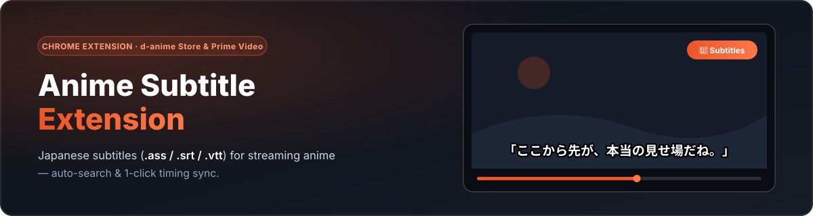

<div align="center">



# Anime Subtitle Extension（动漫外挂字幕助手）

**一款用于在 d-anime Store 与 Amazon Prime Video 观看动漫时叠加日语外挂字幕（`.ass` / `.srt` / `.ssa` / `.vtt`）的 Chrome 扩展——支持 Jimaku.cc + AniList 自动检索与点击台词一键对齐时间轴。**

[](LICENSE)
[](https://github.com/kysing02/video-subtitle/releases/latest)
[](extension/manifest.json)
[](extension/i18n.js)
[](extension/manifest.json)

[English](README.md) | [日本語](README.ja.md) | **简体中文**

</div>

---

## 界面概览


---

## 面向动漫观众的核心功能

- **开箱支持 d-anime Store 与 Amazon Prime Video**
  - 在 **d-anime Store** 自动识别番剧标题、集数与副标题，开播即自动匹配并加载最合适的日语字幕。
  - 在 **Amazon Prime Video** 同样支持动漫与真人剧集字幕检索，并在换集时自动重置。
- **跨季与分割季度自动匹配 (`AniList` + `Jimaku.cc`)**
  - 通过 AniList 关联续作链条，自动处理总集数与分季集数映射，并记住每部作品的字幕条目选择。
- **点击台词一键对轴**
  - 点击画面上的字幕即可展开台词列表，点击当前听到的台词瞬间完成整条字幕的时间轴对齐（也可切换为点击跳转视频进度）。
- **可折叠拖拽的「字幕源优先级 & 默认偏移」词典**
  - 支持拖动排序 `ABEMA`、`DMMTV`、`Netflix`（默认 `-1.0s`）等字幕源并在行内设定默认偏移（`Other` 固定 `0.0s` 且不可删除）。
  - 手动微调的时间偏移会按作品和字幕源自动记忆。
- **本地字幕拖放加载与 SRT 导出**
  - 可将 `.ass` / `.srt` / `.ssa` / `.vtt` 文件直接拖放到视频页面任意位置加载，并支持一键导出调整后的 `.srt` 文件。
- **舒适默认样式与三语界面**
  - 默认设置：**字体比例 `4.5%`**、**底部位置 `5%`**、**背景全透明 (`0%`)**，内置 **简体中文 / English / 日本語** 实时切换。

---

## 快速安装

1. **获取扩展程序**：
   - **推荐方式**：前往 **[Releases 页面](https://github.com/kysing02/video-subtitle/releases)** 下载最新版 `anime-subtitle-extension-v*.zip` 并解压。
   - **或使用 Git 克隆**：
     ```bash
     git clone https://github.com/kysing02/video-subtitle.git
     ```
2. 在 Chrome 打开 `chrome://extensions/` 并开启右上角的 **开发者模式**。
3. 点击 **加载已解压的扩展程序**，选择解压后的文件夹（若使用 Git 克隆，则选择 [`extension/`](extension/) 目录）。
4. *(启用自动检索)* 前往 [jimaku.cc/account](https://jimaku.cc/account) 免费申请 API Key，在扩展弹窗或播放器面板「⚙ 设置」中粘贴保存即可。

---

## 快捷键与常用操作

| 操作 | 快捷键 / 交互方式 |
| :--- | :--- |
| 显示 / 隐藏字幕 | `Alt + S` |
| 微调时间轴 (`-0.5s` / `+0.5s`) | `[` / `]` |
| 展开台词列表进行对轴或跳转 | 直接点击画面上的字幕 |
| 上下调整字幕位置 | 上下拖动画面上的字幕 |
| 快捷时间微调 (`-5s` 至 `+5s`) | 「💬 字幕」面板底部控制栏 |

---

## 参与贡献 & 开源协议

想为更多视频网站添加适配器或了解项目架构与测试命令，请参阅 **[Contributor Guide (英文)](docs/CONTRIBUTING.md)**。

[MIT License](LICENSE)
