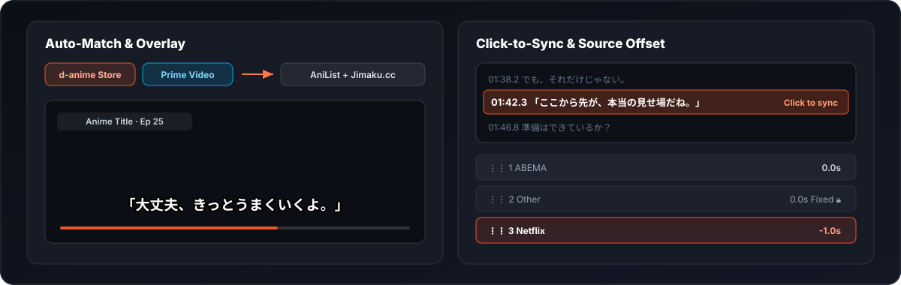
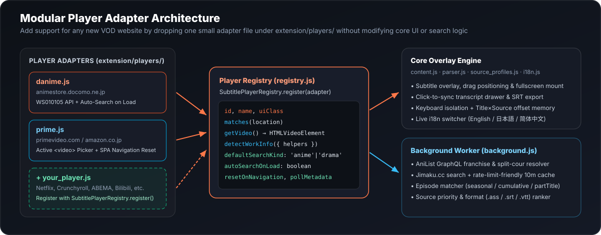

<div align="center">


# 外挂字幕叠加助手 (Subtitle Overlay Assistant)

**一款支持多种在线视频播放器的 Chrome MV3 扩展，可外挂显示 `.ass` / `.srt` / `.ssa` / `.vtt` 字幕——集成 Jimaku.cc + AniList 智能番剧跨季匹配、点击台词实时对齐时间轴，以及易于扩展的模块化播放器适配器架构。**

[](LICENSE)
[](extension/manifest.json)
[](extension/i18n.js)
[](extension/players/registry.js)

[English](README.md) | [日本語](README.ja.md) | **简体中文**

</div>

---

## 功能界面预览



---

## 项目简介

对于日语学习者、需要辅助字幕的观众以及流媒体多平台用户而言，许多视频平台缺少可切换的外挂日语字幕。

**Subtitle Overlay Assistant** 能够在网页视频（包括全屏模式）上方叠加清晰、可定制的外挂字幕。目前开箱即支持 **d-anime Store** 与 **Amazon Prime Video**，并将站点专属逻辑抽离至独立适配器中，方便社区开发者轻松扩展到更多播放器平台。

---

## 已支持平台

| 平台 | 适配器 | 识别与检索机制 |
| :--- | :--- | :--- |
| **d-anime Store** (`animestore.docomo.ne.jp`) | [`extension/players/danime.js`](extension/players/danime.js) | 通过 `WS010105` 接口与页面 DOM 提取作品名、集数与单集副标题（`partTitle`），支持打开视频后自动检索并应用字幕。 |
| **Amazon Prime Video** (`primevideo.com`, `amazon.co.jp`) | [`extension/players/prime.js`](extension/players/prime.js) | 自动定位面积最大的活跃 `<video>` 元素，提取 `atvwebplayersdk` 标题与分集文本，支持剧集/动画检索及 SPA 换集自动重置。 |
| **更多视频网站** | 模块化适配器 API | 只需在 `extension/players/` 中添加一个适配器文件即可接入新平台（参见 [贡献指南](#贡献指南添加新播放器适配器)）。 |

---

## 核心特性

- **跨季与分割季度智能检索 (`Jimaku.cc` + `AniList`)**
  - 通过 AniList GraphQL 关联前作与续作链条，自动处理「总集数 vs 分季集数」换算（例如自动识别第 2 季、分割播出的剧集映射）。
  - 智能清理版本或放送标签的同时保留《【我推的孩子】》等作品原名中的书名号。
  - 支持分集副标题（`partTitle`）匹配与日剧/真人作品检索；当首选条目没有对应分集时自动尝试后续候选条目，并记住每部作品的条目选择偏好。
- **可折叠、可拖拽排序的「字幕源优先级 & 默认偏移」词典**
  - 以一对一列表方式统一管理**字幕源优先级**与各字幕源的**默认时间轴偏移**（例如 `Netflix` 默认 `-1.0s`）。
  - 采用折叠手风琴设计，边看视频边展开即可通过拖拽手柄（`⋮⋮`）调整优先顺序，并在行内直接微调偏移秒数或添加自定义字幕源。
  - `Other` 作为兜底分类可拖动调整排序，但默认偏移锁定为 `0.0s` 且不可删除。
- **按作品与字幕源自动记忆时间轴**
  - 加载字幕时自动按优先级应用偏移：`作品 × 字幕源记忆` → `作品记忆` → `字幕源默认偏移` → `0.0s`。
- **点击台词快速对轴（交互式字幕抽屉）**
  - 点击画面上正在显示的字幕（或聚焦后按 `Enter` / `Space`）即可展开可滚动字幕列表（`#danime-sub-lyrics`）。
  - 点击当前听到的台词即可将整条字幕时间轴瞬间对齐（**将此台词对齐当前时间**），也可切换为点击跳转视频进度模式。
- **本地字幕导入与 SRT 导出**
  - 支持 `.ass`、`.ssa`、`.srt`、`.vtt`（自动跳过双语 ASS 中非日语/辅助样式文本行）。
  - 支持在页面任意位置拖放字幕文件加载，并支持一键导出调整后的 `.srt` 文件。
- **默认样式优化与键位防干扰**
  - 开箱默认参数：**字体大小比例 `4.5%`**（随视频窗口高度自适应）、**底部位置 `5%`**、**背景不透明度 `0%`（全透明加黑边描边）**。
  - 面板操作期间屏蔽网页端播放器快捷键（如 `Space`、方向键、`F`、`M`、`Enter`），避免打字误触发快进或暂停。
  - 对 API 密钥输入框做了防弹窗处理，避免浏览器频繁弹出“是否保存密码”提示。
- **完整三语界面支持 (`English` / `日本語` / `简体中文`)**
  - 支持 Chrome `_locales` 多语言清单与扩展内实时语言切换，控制面板与工具栏弹窗即时同步。

---

## 安装指南

1. 克隆或下载本仓库：
   ```bash
   git clone https://github.com/kysing02/video-subtitle.git
   ```
2. 在 Chrome 浏览器打开 `chrome://extensions/`。
3. 开启右上角的 **开发者模式**。
4. 点击 **加载已解压的扩展程序**，选择仓库内的 [`extension/`](extension/) 目录。
5. *(如需启用自动检索)* 前往 [jimaku.cc/account](https://jimaku.cc/account) 免费获取 API Key，在扩展弹窗或播放器面板的「⚙ 设置」中填写并保存。

---

## 快捷键与操作说明

| 操作 | 快捷键 / 交互方式 |
| :--- | :--- |
| 显示 / 隐藏字幕 | `Alt + S` |
| 微调时间轴 (`-0.5s` / `+0.5s`) | `[` / `]` |
| 打开台词列表并点击对齐 / 跳转 | 直接点击画面上显示的字幕文本 |
| 调整字幕垂直位置 | 上下拖动画面上的字幕文本 |
| 快速时间偏移 (`-5s` 至 `+5s`) | 控制面板底部时间轴控制条 |

---

## 贡献指南：添加新播放器适配器



站点相关的视频检测逻辑全部封装在 [`extension/players/`](extension/players/) 目录中，开发者无需改动核心字幕引擎或检索代码即可支持新平台。

### 1. 创建 `extension/players/<site>.js`

调用 `window.SubtitlePlayerRegistry.register(...)` 注册适配器对象：

```js
(function (root) {
  'use strict';

  const registry = root.SubtitlePlayerRegistry;
  if (!registry) return;

  registry.register({
    id: 'myvod',
    name: 'MyVOD',
    matches: (loc) => /(^|\.)myvod\.example$/.test(loc.hostname),

    defaultSearchKind: 'anime', // 'anime' 或 'drama'
    autoSearchOnLoad: true,     // true: 识别剧集后自动检索并应用字幕
    resetOnNavigation: true,    // true: SPA 页面地址变化时重置当前字幕
    pollMetadata: true,         // true: 定时轮询片名与集数变化
    alwaysResolveVideo: false,  // true: 每帧渲染前重新解析目标 <video>
    uiClass: '',                // 可选：附加到面板和悬浮按钮的样式类名

    getVideo() {
      return document.querySelector('video');
    },

    async detectWorkInfo({ cleanWorkTitle, parseEpisodeNumber }) {
      const rawTitle = document.querySelector('.player-title')?.textContent?.trim() || '';
      const rawEp = document.querySelector('.player-episode')?.textContent?.trim() || '';
      if (!rawTitle) return null;
      return {
        partId: location.pathname,
        workTitle: rawTitle,
        cleanTitle: cleanWorkTitle(rawTitle),
        partDispNumber: rawEp,
        partTitle: '',
        episodeNumber: parseEpisodeNumber(rawEp),
      };
    },
  });
})(typeof window !== 'undefined' ? window : globalThis);
```

### 2. 在 `extension/manifest.json` 中声明

1. 将目标域名添加到 `host_permissions` 和 `content_scripts[0].matches`。
2. 在 `content_scripts[0].js` 中将 `"players/<site>.js"` 插入 `"players/registry.js"` 之后、`"content.js"` 之前。

### 3. 运行语法与无头浏览器测试

```bash
node -c extension/players/<site>.js extension/content.js extension/background.js
python3 tests/build-browser-fixture.py
python3 tests/build-browser-fixture.py --search
google-chrome --headless --disable-gpu --no-sandbox --dump-dom "file:///tmp/prime-subtitle-test.html" | grep 'id="result"'
google-chrome --headless --disable-gpu --no-sandbox --dump-dom "file:///tmp/subtitle-search-test.html" | grep 'id="result"'
```

---

## 分支说明

- `main`：稳定发布分支
- `dev`：功能集成与测试分支
- `feat/ai-realtime`：实验性 AI 实时语音转文字字幕分支（尚未稳定，独立保留以便后续完善合并）

---

## 开源协议

本项目基于 [MIT License](LICENSE) 开源。
