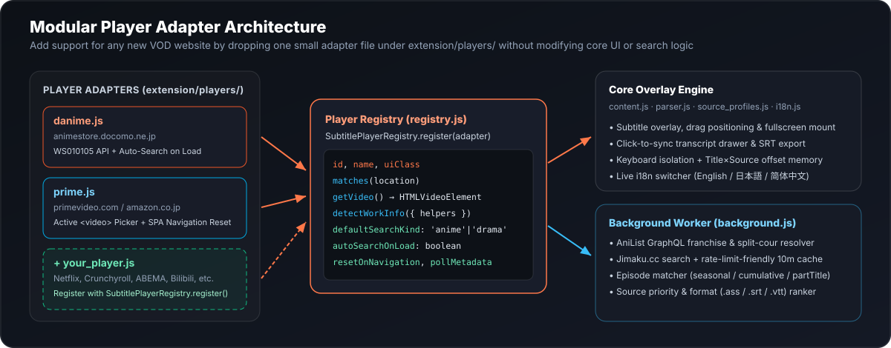

# Contributor Guide

This guide explains how player adapters are separated from the core subtitle overlay engine and how to add support for new video streaming sites or run local verification tests.



---

## Architecture Overview

```text
.
├── extension/
│   ├── _locales/              # Chrome MV3 extension metadata (en, ja, zh_CN)
│   ├── players/
│   │   ├── registry.js        # Player adapter registry & backwards-compatible facade
│   │   ├── danime.js          # d-anime Store adapter
│   │   └── prime.js           # Amazon Prime Video adapter
│   ├── background.js          # Service worker: AniList + Jimaku API, caching & ranking
│   ├── content.js             # Overlay rendering, transcript drawer, shortcuts, storage sync
│   ├── i18n.js                # Runtime EN / JA / ZH-CN UI catalog
│   ├── parser.js              # .ass / .ssa / .srt / .vtt parser & SRT exporter
│   ├── source_profiles.js     # Expandable draggable source priority & default offset widget
│   ├── popup.html / popup.js  # Browser action popup UI
│   ├── styles.css             # Overlay, transcript drawer & control panel styling
│   └── manifest.json          # Chrome Manifest V3 configuration
├── docs/images/               # Documentation graphics
└── tests/                     # Offline HTML fixtures & browser DOM test scripts
```

---

## Adding a New Player Adapter

All site-specific player integration lives under [`extension/players/`](/extension/players/). Core subtitle parsing, overlay positioning, click-to-sync, i18n, and Jimaku.cc search are handled centrally in [`extension/content.js`](/extension/content.js) and [`extension/background.js`](/extension/background.js).

### 1. Create `extension/players/<site>.js`

Implement an adapter object and register it via `window.SubtitlePlayerRegistry.register(...)`:

```js
/**
 * Example Player Adapter
 */
(function (root) {
  'use strict';

  const registry = root.SubtitlePlayerRegistry;
  if (!registry) return;

  registry.register({
    id: 'myvod',
    name: 'MyVOD',
    matches: (loc) => /(^|\.)myvod\.example$/.test(loc.hostname),

    // Behavior flags read by content.js
    defaultSearchKind: 'anime', // 'anime' | 'drama'
    autoSearchOnLoad: true,     // true = auto-search & apply best match when metadata loads
    resetOnNavigation: true,    // true = reset cues & offset on SPA URL changes
    pollMetadata: true,         // true = periodically re-check DOM metadata
    alwaysResolveVideo: false,  // true = re-query active <video> on every render tick
    uiClass: '',                // Optional CSS class added to #danime-sub-fab & #danime-sub-panel

    // Return the active <video> element for playback sync
    getVideo() {
      return document.querySelector('video');
    },

    // Return { partId, workTitle, cleanTitle, partDispNumber, partTitle, episodeNumber }
    async detectWorkInfo({ cleanWorkTitle, parseEpisodeNumber }) {
      const rawTitle = document.querySelector('.player-title')?.textContent?.trim() || '';
      const rawEp = document.querySelector('.player-episode')?.textContent?.trim() || '';
      if (!rawTitle) return null;
      return {
        partId: location.pathname,
        workTitle: rawTitle,
        cleanTitle: cleanWorkTitle(rawTitle),
        partDispNumber: rawEp,
        partTitle: '',
        episodeNumber: parseEpisodeNumber(rawEp),
      };
    },
  });
})(typeof window !== 'undefined' ? window : globalThis);
```

### 2. Register Origins & Load Order in `extension/manifest.json`

1. Add your site's origin pattern to `host_permissions` and `content_scripts[0].matches`.
2. Add `"players/<site>.js"` inside `content_scripts[0].js` after `"players/registry.js"` and before `"content.js"`.

---

## Running Local Verification

Run syntax checks, manifest validation, and offline headless Chromium browser tests before submitting a PR:

```bash
# 1. JS syntax & JSON validation
for f in extension/*.js extension/players/*.js; do node -c "$f"; done
python3 -c "
import json
for p in [
    'extension/manifest.json',
    'extension/_locales/en/messages.json',
    'extension/_locales/ja/messages.json',
    'extension/_locales/zh_CN/messages.json',
]:
    json.load(open(p, encoding='utf-8'))
"

# 2. Build offline test fixtures and run headless Chrome verification
python3 tests/build-browser-fixture.py
python3 tests/build-browser-fixture.py --search
google-chrome --headless --disable-gpu --no-sandbox --dump-dom "file:///tmp/prime-subtitle-test.html" | grep 'id="result"'
google-chrome --headless --disable-gpu --no-sandbox --dump-dom "file:///tmp/subtitle-search-test.html" | grep 'id="result"'
```

Also update [`tests/build-browser-fixture.py`](/tests/build-browser-fixture.py) if you add a new adapter script so offline fixture tests include it.

---

## Branch Conventions

- `main`: Stable production releases.
- `dev`: Integration branch reviewed before merging to `main`.
- `feat/ai-realtime`: Experimental real-time AI speech-to-text transcription branch (kept separate while unstable).
